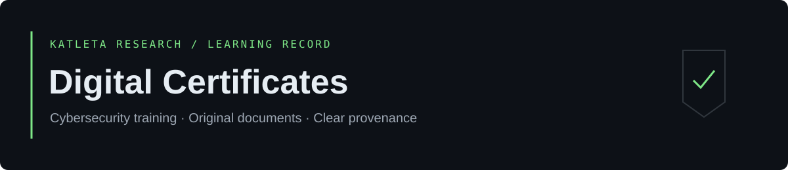
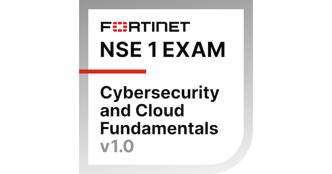

<a href="https://github.com/KatletaLabs">Profile</a> · <a href="#vendor-certification">Certification</a> · <a href="#courses-and-learning-badges">Courses</a> · <a href="CONTRIBUTING.md">Add a credential</a>

# Cybersecurity credentials

**Yaroslav Mikhailovich Ivanov · Katleta Research**

A focused record of cybersecurity education, supported by original documents and issuer credential pages.

## Vendor certification

### Fortinet NSE 1 Certified in Cybersecurity

**Entry-level vendor certification.** Covers the threat landscape and cybersecurity fundamentals. Featured ahead of course completions because it is an issuer-designated certification; this does not imply advanced engineering proficiency.

| Issuer | Evidence | Issued | Expires | Status |
| :--- | :--- | :--- | :--- | :--- |
| Fortinet | [Credly](https://www.credly.com/badges/0fbb28a1-980e-45e5-abb7-ad7c988bea83/public_url) | Not confirmed | Not confirmed | Earned; current validity not confirmed |

The public credential page identifies **Yaroslav Ivanov** as the recipient. Issue and expiry dates were not available in the retrieved page metadata; consult the live issuer record for current validity.

## Courses and learning badges

| Achievement | Issuer | Issued | Status | Expires | Evidence |
| :--- | :--- | :--- | :--- | :--- | :--- |
| **Cybersecurity and Cloud Fundamentals 1.0** | Fortinet Training Institute | 2026-10-14 | Completed · course + badge | Not specified in PDF | [PDF](certificates/fortinet/2026-10-14-cybersecurity-and-cloud-fundamentals-1.0.pdf) · [Credly](https://www.credly.com/badges/522f7984-3adc-45da-99a9-037437301523/public_url) |
| **Cybersecurity Fundamentals** | IBM SkillsBuild | 2026-10-13 | Earned · digital badge | Not specified in PDF | [PDF](certificates/ibm/2026-10-13-cybersecurity-fundamentals.pdf) · [Credly](https://www.credly.com/badges/a5e30cb9-27c7-4980-95d3-46da80afd726/public_url) |
| **Cyber Hygiene · Кибергигиена** | Kaspersky Academy | 2026-10-12 | Completed · course | Not specified in PDF | [PDF](certificates/kaspersky/2026-10-12-cyber-hygiene.pdf) · [Issuer](https://certification.kaspersky.com/api/PageOfCertificate/7086d185-e521-46e2-82d3-4204b20eab48) |

The Fortinet course and NSE 1 credential are related records, shown separately by type. They are not presented as two independent advanced qualifications.

## Learning focus

These are portfolio topic tags, not claims of hands-on proficiency or verbatim issuer skill lists.

| Achievement | Description | Topic tags |
| :--- | :--- | :--- |
| Fortinet NSE 1 | Entry-level cybersecurity certification; threat landscape and security fundamentals. | `cybersecurity-fundamentals` `threat-landscape` |
| Fortinet Cybersecurity and Cloud Fundamentals | Completion of the vendor's introductory cybersecurity and cloud course. | `cybersecurity-fundamentals` `cloud-fundamentals` |
| IBM Cybersecurity Fundamentals | Foundational cybersecurity learning credential. | `cybersecurity-fundamentals` |
| Kaspersky Cyber Hygiene | Completion of the online cyber hygiene course; English title translated from Russian. | `cyber-hygiene` `security-awareness` |

Specific `network-security` or `cloud-security` skills will be added when supported by a syllabus, issuer skill list, or practical work.

## Repository guide

| Location | Purpose |
| :--- | :--- |
| [certificates/](certificates/) | Original PDFs grouped by issuer. |
| [badges/](badges/) | Issuer badge images grouped by issuer. |
| [notes/](notes/) | Evidence notes and a template for original study notes. |
| [CONTRIBUTING.md](CONTRIBUTING.md) | Naming, metadata, upload and review workflow. |
| [SHA256SUMS](SHA256SUMS) | Integrity hashes for certificate and badge files. |

Dates use `YYYY-MM-DD`. **Completed** denotes a course; **Earned** denotes an awarded credential. **Active/Expired** requires confirmed validity dates and a current issuer status. Missing expiry information does not mean lifetime validity.

Original PDFs are preserved unchanged. Checksums detect file changes; they do not authenticate an issuer. See [evidence notes](notes/credential-evidence.md) for source details and verification limits.

## Rights

The [MIT license](LICENSE) applies to original repository documentation and artwork. Issuer certificates, badge artwork, signatures, logos and trademarks remain subject to their respective rights.

Katleta Research · Continuous learning, documented.
